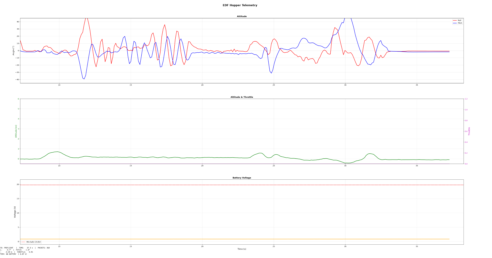

# Case study: hopper-fc, a flight-computer testbed for a thrust-vane hopper

## Summary

hopper-fc is Teensy 4.1 firmware for a planned electric-ducted-fan hopper steered by four thrust vanes, plus a Python ground station that plots its telemetry. It is bench-tested only: sensors, telemetry and ground station work on my desk, and nothing has been connected to an actuator. It demonstrates sensor bring-up, a fixed-rate control loop, a small serial protocol and host-side testing, and records plainly what is not verified.

## The problem

I want to work toward guidance, navigation and control for liquid rockets. A thrust-vane hopper is a cheap way to practise: its vane mixer solves the same allocation problem as an engine cluster, turning pitch, roll and yaw commands into per-actuator commands, so I can work on estimation, control and telemetry before I have any propulsion hardware.

## What I built

**Firmware** (`src/main.cpp`, about 800 lines, Arduino framework under PlatformIO). A fixed 100 Hz loop reads the BNO08x (game-rotation-vector quaternion converted to roll/pitch/yaw, plus linear acceleration), a BMP580 barometer and an INA219 (battery voltage and current). A 2-state Kalman filter (baro measurement, IMU z acceleration as input) estimates altitude. Safety aborts fire on battery below 19.8 V, tilt above 45 degrees or altitude above 20 m. A 7-state machine (PREFLIGHT, ARMED, TAKEOFF, HOVER, LANDING, LANDED, ABORT) and four PIDs (pitch, roll, yaw, altitude) feed a mixer for four vane servos (N = -pitch + yaw, E = roll - yaw, S = pitch + yaw, W = -roll - yaw) plus one ESC. Single-character serial commands: arm, disarm, takeoff, land, abort, reset, status.

**Telemetry.** A 24-byte frame at 10 Hz on the Teensy's second USB serial port (`SerialUSB1`): sync bytes `AA 55`, a state byte, five little-endian float32 values (roll, pitch, altitude, throttle, battery voltage) and an XOR checksum over the 21 payload bytes.

**Ground station** (`ground-station/ground_station.py`). A resyncing frame parser and live matplotlib plots. `test_parser.py` has six unit tests, including bad-checksum recovery and a frame split at every possible byte boundary.

## Engineering decisions

**1. From a bare 21-byte packet to a framed, checksummed one.** My earlier sketch (now in `archive/`) sent a 21-byte LoRa packet with no header or checksum, so a receiver joining mid-stream or seeing a corrupted byte could not tell. The current frame adds sync bytes and a checksum (`7f34c1c`); after a bad checksum the host parser skips one byte and rescans. I wrote it and its tests before connecting the board (`e76d6c2`).

**2. Separate ports for commands and telemetry.** `-DUSB_DUAL_SERIAL` (`7f34c1c`) gives the Teensy two USB serial ports. Text commands and prints stay on the first and binary telemetry on the second, so a stray print cannot corrupt a frame. The ground station had a command uplink the firmware never read; I removed it rather than leave code that looked like it worked (`1c2a3ca`).

**3. A battery check that does not fire on the bench.** With no battery on the INA219 the bus reads near 0 V, which would trip the low-voltage abort immediately. The check only applies when the INA219 initialised and the reading is above 5 V (`13f7552`). The cost: a battery collapsed below 5 V would not trigger an abort. That is fine on the bench and must be revisited before flight.

**4. Diagnosing a dead IMU that was pulling down the I2C bus.** My first IMU was a BNO055. The commit that records it (`162092c`) says it was defective and pulled the I2C bus low, so it needed replacing; that commit swaps the sketch for an I2C scanner. I carried on with a temporary MPU6050 (`49d59ca`), then moved to a BNO08x (`08d6227`), which does its own sensor fusion, so the firmware has no attitude filter of its own.

## Verified on hardware



- Sensors initialise on I2C.
- Ground-level baro calibration runs.
- Firmware boots and tilt readings follow the IMU.
- Telemetry: 33 valid frames in 3 s (about 10 Hz) with 0 bad checksums, decoded on the host.
- Parser unit tests pass 6/6 (host-side only).
- The ground station ran live against the board on `SerialUSB1`. Plots tracked roll, pitch and altitude as I tilted and lifted it. A 60-second screen recording exists.

## Not yet done

- No airframe, vanes, servos, ESC or fan exist. The servo and ESC output code has never run on real actuators.
- Closed-loop control and flight are unverified: PID gains, Kalman tuning, the state machine and safety aborts have not run on a vehicle.
- No real battery has been connected to the INA219.
- SD logging is disabled (a commented-out placeholder).
- LoRa telemetry has not been started in the current firmware.
- GPS is read but not used.
- Known gaps: the yaw PID has no +-180 degree wrap; the altitude Kalman filter uses body-frame acceleration with no rotation into the world frame; `HOVER_BASE_US` is a guess; `ROLL_SIGN`/`PITCH_SIGN` are unverified.

## Next steps

1. Fix the yaw wrap; rotate acceleration into the world frame before the Kalman predict step.
2. Enable SD logging so bench runs can be replayed.
3. Check the voltage abort against a real battery on the INA219.
4. Build a one-servo, one-vane rig to verify axis signs and mixer polarity before any fan is involved.

## What this means for your project

I can bring up and debug sensors on real hardware, as with the dead IMU that held the I2C bus low. I can design a serial protocol and build the host tooling and tests around it. I report plainly what is and isn't verified, and everything beyond the bench is listed above as not done.

## Repo layout

```
src/main.cpp        flight firmware
ground-station/     ground_station.py, test_parser.py
tools/              I2C scanner, sensor monitor (bring-up sketches)
archive/            older sketch for earlier hardware, not built
```
